# Laporan Milestone 2a / Komparasi Kinerja PySpark
**Nama:** Paul Yang **NIM:** 42430043  **Run ID:** ...

## 1. Lingkungan pengujian
Laptop Asus Tuf Gaming F15 (2x8gb Ram/I5 13500h), 
Docker Version 29.8.1, 
Redpanda v26.2.5 (1 broker), MinIO (S3-compatible), Iceberg REST Catalog 1.6.0, dan Apache Spark 3.5.3 mode `local[4]` (4 thread lokal)
1.000.000 event (dataset sintetis pada run ID `kelas-1m`), 
3 partisi pada topik Kafka `ecommerce.orders` (replication factor 1) dan 8 partisi shuffle pada Spark (`spark.sql.shuffle.partitions = 8`), 
16 bucket (`--salt-buckets 16`)
Adaptive Query Execution (AQE): Off (`spark.sql.adaptive.enabled = false`)
Dinonaktifkan (`spark.sql.autoBroadcastJoinThreshold = -1`) agar strategi *SortMergeJoin* dan *BroadcastHashJoin* dapat dibandingkan secara terkontrol

## 2. Topologi dan aliran data
+-----------------------+      +-----------------------------------+      +------------------------------------+
|  01_producer.py       | ---> |  Redpanda Broker (Kafka API)      | ---> |  02_consumer_raw_minio.py          |
|  1.000.000 events     |      |  Topik: ecommerce.orders          |      |  Batch JSONL + At-Least-Once       |
|  run-id: kelas-1m     |      |  (3 Partisi, RF = 1)              |      |  Commit offset setelah upload OK   |
+-----------------------+      +-----------------------------------+      +------------------------------------+
                                                                                            |
                                                                                            v
+------------------------------------+      +-----------------------------------+      +-----------------------+
|  Apache Iceberg + MinIO warehouse  | <--- |  PySpark (04_spark_pipeline.py)   | <--- |  MinIO Bucket: raw    |
|  lake.curated.orders_clean         |      |  Baca s3a://raw -> Cleaning &     |      |  events/run_id=       |
|  lake.curated.sales_summary        |      |  Deduplikasi -> Uji Optimasi      |      |  kelas-1m/partition=* |
|  (Metadata via REST Catalog :8181) |      |  (Salting, Join) -> Spark UI :4040|      |  /*.jsonl             |
+------------------------------------+      +-----------------------------------+      +-----------------------+

Event Ingestion: Skrip 01_producer.py membangkitkan 1.000.000 event transaksi sintetik (sekitar 80% berasal dari kota Denpasar, 10% Jakarta, dan 10% Surabaya) dan mengirimkannya ke topik ecommerce.orders (3 partisi) pada broker Redpanda dengan product_id sebagai message key.

Raw Landing (At-Least-Once): Skrip 02_consumer_raw_minio.py menarik event sesuai run_id secara polling, menggabungkannya menjadi objek berformat JSON Lines (.jsonl), dan menyimpannya ke bucket raw pada MinIO. Posisi offset partisi hanya di-commit setelah objek dipastikan berhasil terunggah ke MinIO.

Pemrosesan Batch & Optimasi (PySpark): Skrip 04_spark_pipeline.py membaca data mentah dari s3a://raw/events/run_id=kelas-1m/partition=*/*.jsonl menggunakan skema eksplisit, membersihkan data tidak valid, menghapus duplikat berdasarkan (run_id, order_id), serta menjalankan eksperimen groupBy, data skew & key salting, dan perbandingan SortMergeJoin vs BroadcastHashJoin.

Curated Storage (Apache Iceberg): Data bersih dan ringkasan penjualan disimpan ke tabel terkelola Apache Iceberg (lake.curated.orders_clean dan lake.curated.sales_summary) yang dipartisi berdasarkan sale_date. Metadata dan namespace dikelola oleh Iceberg REST Catalog (http://rest:8181), sedangkan berkas data dan metadata fisiknya tersimpan di bucket warehouse MinIO.

## 3. Validasi dan kualitas data
| Metrik Kualitas Data | Jumlah Baris | Persentase | Keterangan |
|---|---:|---:|---|
| Raw (`raw_count`) | 1.000.000 | 100,00% | Total event JSONL yang dibaca dari `s3a://raw/events/run_id=kelas-1m/` |
| Valid / Bersih (`clean_count`) | 998.005 | 99,80% | Baris yang lolos seluruh aturan validasi dan deduplikasi |
| Ditolak / Duplikat (`rejected`) | 1.995 | 0,20% | Baris dengan `city` kosong, `amount` null/negatif, `quantity <= 0`, atau duplikat |
| Curated Iceberg (`orders_clean`) | 998.005 | 99,80% | Terverifikasi identik dengan `clean_count` melalui validasi skrip |

**Alasan Penerapan Aturan Cleaning & Standardisasi:**
1. **Skema Eksplisit (`StructType`):** Pembacaan file JSONL menggunakan skema tipe data eksplisit agar struktur kolom konsisten dan menghindari kesalahan *schema inference*.
2. **Standardisasi Format:** Kolom `city` dirapikan menggunakan `initcap(trim(col("city")))`, sedangkan `event_time` dikonversi menjadi kolom tanggal `sale_date` (`to_date`) untuk kebutuhan partisi tabel Iceberg.
3. **Filter Integritas Nilai (`city != ""`, `amount IS NOT NULL & >= 0`, `quantity > 0`):** Pada generator data, beberapa event sengaja dibuat tidak valid (kota kosong dan `amount` bernilai `NULL`). Filter ini memastikan hanya transaksi bernilai wajar dan memiliki dimensi kota yang valid yang masuk ke perhitungan agregasi bisnis.
4. **Deduplikasi (`dropDuplicates(["run_id", "order_id"])`):** Karena *consumer* Kafka ke MinIO menerapkan semantik *at-least-once* (*offset* di-*commit* setelah unggah objek berhasil), potensi *replay* pesan bisa terjadi jika proses terhenti sebelum *commit*. Deduplikasi menjamin setiap transaksi unik tidak pernah dihitung ganda.

**Pemeriksaan Iceberg Row Count:**
Setelah DataFrame bersih ditulis ke tabel `lake.curated.orders_clean`, dilakukan pengecekan baris (`spark.table("lake.curated.orders_clean").count()`) dan hasilnya lolos *assertion* terhadap `clean_count` dengan total tepat **998.005 baris** (status log: `SEMUA VALIDASI LULUS`).

## 4. Analisis execution plan dan shuffle
### A. Lokasi Operator `Exchange` pada Physical Plan
Berdasarkan diagram Spark SQL dan berkas `hasil/kelas-1m/plan_A_groupby_baseline.txt`, operasi agregasi (`groupBy` / `dropDuplicates` / `count`) memicu transformasi *wide* yang ditandai oleh munculnya operator **`Exchange`**:
* **Transformasi Narrow vs Wide:** Operasi `filter()` dan `withColumn()` pada tahap *cleaning* bersifat *narrow* sehingga dijalankan langsung dalam partisi masing-masing tanpa memindahkan data antar-task. Sebaliknya, `dropDuplicates(["run_id", "order_id"])` dan `groupBy("city")` bersifat *wide* karena memerlukan pengelompokan baris menurut kunci (*hash key*).
* **Peran `Exchange`:** Pada diagram SQL, operator `Exchange` berada di antara `HashAggregate` parsial (sebelum *shuffle*) dan `HashAggregate` final (sesudah *shuffle*). Operator ini membentuk batas antar-*stage* (*shuffle boundary*) untuk mendistribusikan ulang data antarpartisi.

== Physical Plan ==
* HashAggregate (13)
+- Exchange (12)
   +- * HashAggregate (11)
      +- InMemoryTableScan (1)
            +- InMemoryRelation (2)
                  +- SortAggregate (10)
                     +- * Sort (9)
                        +- Exchange (8)
                           +- SortAggregate (7)
                              +- * Sort (6)
                                 +- * Project (5)
                                    +- * Filter (4)
                                       +- Scan json  (3)


(1) InMemoryTableScan
Output [2]: [city#26, amount#6L]
Arguments: [city#26, amount#6L]

(2) InMemoryRelation
Arguments: [run_id#0, order_id#1L, sale_date#35, city#26, product_id#4, quantity#5, amount#6L], CachedRDDBuilder(org.apache.spark.sql.execution.columnar.DefaultCachedBatchSerializer@7cb96362,StorageLevel(disk, memory, 1 replicas),SortAggregate(key=[run_id#0, order_id#1L], functions=[first(sale_date#35, false), first(city#26, false), first(product_id#4, false), first(quantity#5, false), first(amount#6L, false)], output=[run_id#0, order_id#1L, sale_date#62, city#54, product_id#56, quantity#58, amount#60L])
+- *(2) Sort [run_id#0 ASC NULLS FIRST, order_id#1L ASC NULLS FIRST], false, 0
   +- Exchange hashpartitioning(run_id#0, order_id#1L, 8), ENSURE_REQUIREMENTS, [plan_id=50]
      +- SortAggregate(key=[run_id#0, order_id#1L], functions=[partial_first(sale_date#35, false), partial_first(city#26, false), partial_first(product_id#4, false), partial_first(quantity#5, false), partial_first(amount#6L, false)], output=[run_id#0, order_id#1L, first#73, valueSet#74, first#75, valueSet#76, first#77, valueSet#78, first#79, valueSet#80, first#81L, valueSet#82])
         +- *(1) Sort [run_id#0 ASC NULLS FIRST, order_id#1L ASC NULLS FIRST], false, 0
            +- *(1) Project [run_id#0, order_id#1L, initcap(trim(city#3, None)) AS city#26, product_id#4, quantity#5, amount#6L, cast(gettimestamp(event_time#2, yyyy-MM-dd'T'HH:mm:ss, TimestampType, Some(Etc/UTC), false) as date) AS sale_date#35]
               +- *(1) Filter (((((((((isnotnull(quantity#5) AND isnotnull(product_id#4)) AND isnotnull(order_id#1L)) AND NOT (initcap(trim(city#3, None)) = )) AND isnotnull(cast(gettimestamp(event_time#2, yyyy-MM-dd'T'HH:mm:ss, TimestampType, Some(Etc/UTC), false) as date))) AND isnotnull(amount#6L)) AND (amount#6L >= 0)) AND (quantity#5 > 0)) AND (product_id#4 >= 1)) AND (product_id#4 <= 200))
                  +- FileScan json [run_id#0,order_id#1L,event_time#2,city#3,product_id#4,quantity#5,amount#6L] Batched: false, DataFilters: [isnotnull(quantity#5), isnotnull(product_id#4), isnotnull(order_id#1L), NOT (initcap(trim(city#3..., Format: JSON, Location: InMemoryFileIndex(484 paths)[s3a://raw/events/run_id=kelas-1m/partition=0/offset-000000008100-000..., PartitionFilters: [], PushedFilters: [IsNotNull(quantity), IsNotNull(product_id), IsNotNull(order_id), IsNotNull(amount), GreaterThanO..., ReadSchema: struct<run_id:string,order_id:bigint,event_time:string,city:string,product_id:int,quantity:int,am...
,None)

(3) Scan json 
Output [7]: [run_id#0, order_id#1L, event_time#2, city#3, product_id#4, quantity#5, amount#6L]
Batched: false
Location: InMemoryFileIndex [s3a://raw/events/run_id=kelas-1m/partition=0/offset-000000008100-000000009289.jsonl, ... 483 entries]
PushedFilters: [IsNotNull(quantity), IsNotNull(product_id), IsNotNull(order_id), IsNotNull(amount), GreaterThanOrEqual(amount,0), GreaterThan(quantity,0), GreaterThanOrEqual(product_id,1), LessThanOrEqual(product_id,200)]
ReadSchema: struct<run_id:string,order_id:bigint,event_time:string,city:string,product_id:int,quantity:int,amount:bigint>

(4) Filter [codegen id : 1]
Input [7]: [run_id#0, order_id#1L, event_time#2, city#3, product_id#4, quantity#5, amount#6L]
Condition : (((((((((isnotnull(quantity#5) AND isnotnull(product_id#4)) AND isnotnull(order_id#1L)) AND NOT (initcap(trim(city#3, None)) = )) AND isnotnull(cast(gettimestamp(event_time#2, yyyy-MM-dd'T'HH:mm:ss, TimestampType, Some(Etc/UTC), false) as date))) AND isnotnull(amount#6L)) AND (amount#6L >= 0)) AND (quantity#5 > 0)) AND (product_id#4 >= 1)) AND (product_id#4 <= 200))

(5) Project [codegen id : 1]
Output [7]: [run_id#0, order_id#1L, initcap(trim(city#3, None)) AS city#26, product_id#4, quantity#5, amount#6L, cast(gettimestamp(event_time#2, yyyy-MM-dd'T'HH:mm:ss, TimestampType, Some(Etc/UTC), false) as date) AS sale_date#35]
Input [7]: [run_id#0, order_id#1L, event_time#2, city#3, product_id#4, quantity#5, amount#6L]

(6) Sort [codegen id : 1]
Input [7]: [run_id#0, order_id#1L, city#26, product_id#4, quantity#5, amount#6L, sale_date#35]
Arguments: [run_id#0 ASC NULLS FIRST, order_id#1L ASC NULLS FIRST], false, 0

(7) SortAggregate
Input [7]: [run_id#0, order_id#1L, city#26, product_id#4, quantity#5, amount#6L, sale_date#35]
Keys [2]: [run_id#0, order_id#1L]
Functions [5]: [partial_first(sale_date#35, false), partial_first(city#26, false), partial_first(product_id#4, false), partial_first(quantity#5, false), partial_first(amount#6L, false)]
Aggregate Attributes [10]: [first#63, valueSet#64, first#65, valueSet#66, first#67, valueSet#68, first#69, valueSet#70, first#71L, valueSet#72]
Results [12]: [run_id#0, order_id#1L, first#73, valueSet#74, first#75, valueSet#76, first#77, valueSet#78, first#79, valueSet#80, first#81L, valueSet#82]

(8) Exchange
Input [12]: [run_id#0, order_id#1L, first#73, valueSet#74, first#75, valueSet#76, first#77, valueSet#78, first#79, valueSet#80, first#81L, valueSet#82]
Arguments: hashpartitioning(run_id#0, order_id#1L, 8), ENSURE_REQUIREMENTS, [plan_id=50]

(9) Sort [codegen id : 2]
Input [12]: [run_id#0, order_id#1L, first#73, valueSet#74, first#75, valueSet#76, first#77, valueSet#78, first#79, valueSet#80, first#81L, valueSet#82]
Arguments: [run_id#0 ASC NULLS FIRST, order_id#1L ASC NULLS FIRST], false, 0

(10) SortAggregate
Input [12]: [run_id#0, order_id#1L, first#73, valueSet#74, first#75, valueSet#76, first#77, valueSet#78, first#79, valueSet#80, first#81L, valueSet#82]
Keys [2]: [run_id#0, order_id#1L]
Functions [5]: [first(sale_date#35, false), first(city#26, false), first(product_id#4, false), first(quantity#5, false), first(amount#6L, false)]
Aggregate Attributes [5]: [first(sale_date#35)()#61, first(city#26)()#53, first(product_id#4)()#55, first(quantity#5)()#57, first(amount#6L)()#59L]
Results [7]: [run_id#0, order_id#1L, first(sale_date#35)()#61 AS sale_date#62, first(city#26)()#53 AS city#54, first(product_id#4)()#55 AS product_id#56, first(quantity#5)()#57 AS quantity#58, first(amount#6L)()#59L AS amount#60L]

(11) HashAggregate [codegen id : 1]
Input [2]: [city#26, amount#6L]
Keys [1]: [city#26]
Functions [2]: [partial_count(1), partial_sum(amount#6L)]
Aggregate Attributes [2]: [count#448L, sum#449L]
Results [3]: [city#26, count#450L, sum#451L]

(12) Exchange
Input [3]: [city#26, count#450L, sum#451L]
Arguments: hashpartitioning(city#26, 8), ENSURE_REQUIREMENTS, [plan_id=108]

(13) HashAggregate [codegen id : 2]
Input [3]: [city#26, count#450L, sum#451L]
Keys [1]: [city#26]
Functions [2]: [count(1), sum(amount#6L)]
Aggregate Attributes [2]: [count(1)#336L, sum(amount#6L)#338L]
Results [3]: [city#26, count(1)#336L AS orders#337L, sum(amount#6L)#338L AS gross_sales#339L]

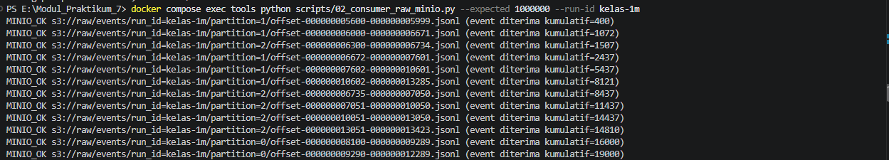 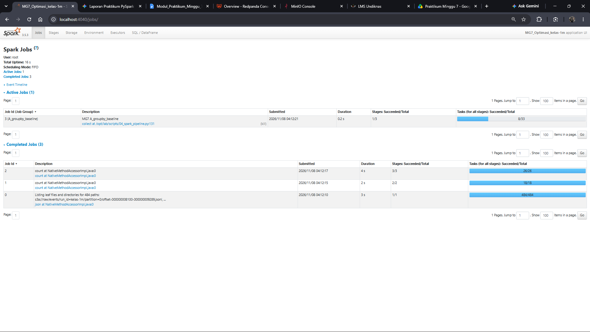 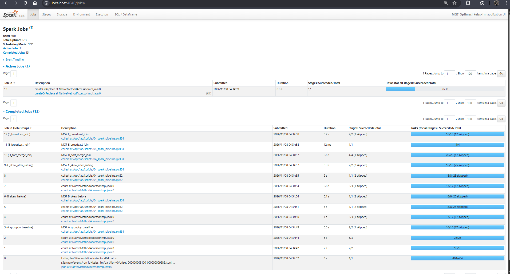 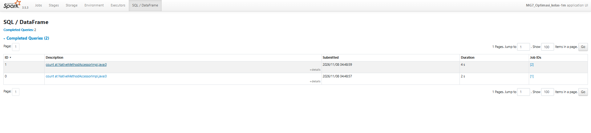 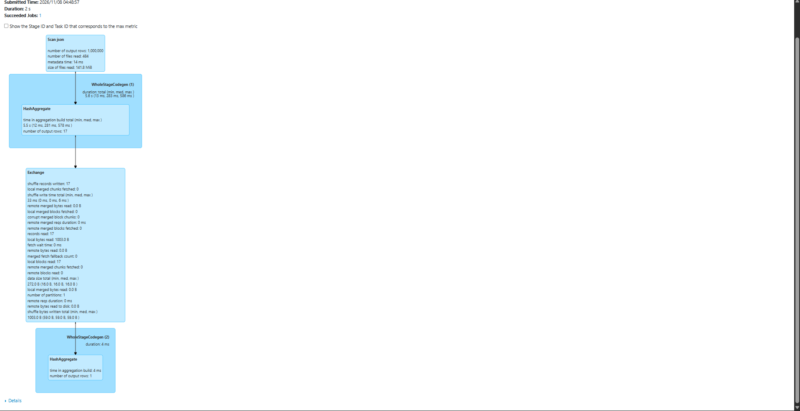 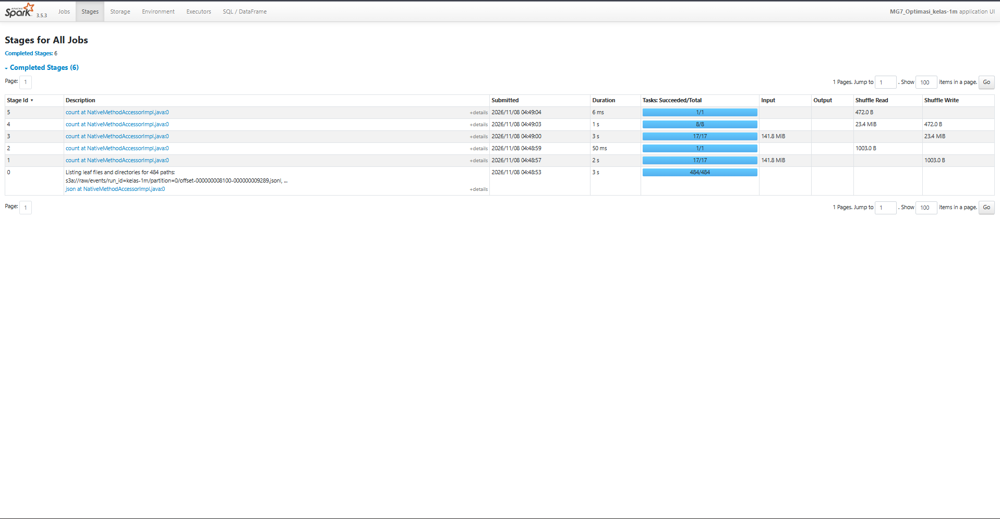

## 5. Penanganan data skew
### A. Perbandingan Distribusi Partisi Sebelum vs Sesudah Salting
Dataset `kelas-1m` memiliki distribusi kota yang sangat timpang (~80% transaksi berasal dari kota Denpasar, ~10% Jakarta, dan ~10% Surabaya). Ketika dilakukan `repartition(8, "city")`, seluruh baris dengan nama kota yang sama diarahkan ke hash partisi yang sama sehingga beban antar-task menjadi tidak seimbang.

| Metrik Distribusi Partisi (`998.005` baris bersih) | Sebelum Salting (`repartition(8, "city")`) | Sesudah Salting (`repartition(8, "city", "salt")`) | Perubahan |
|---|---:|---:|---|
| Jumlah Total Partisi | 8 | 8 | Tetap |
| Partisi Kosong (`0` baris) | 5 | 0 | Seluruh partisi aktif terisi |
| Beban Partisi Maksimum (`max`) | 798.404 baris | 281.164 baris | Turun 64,78% |
| Skew Index | 6,40 | 2,25 | Keseimbangan membaik signifikan |
| Durasi Eksekusi | 0,1752 detik | 0,3270 detik | Speedup `0,54x` (-86,64% lebih lambat) |

scenario,partition_id,rows
skew,0,0
skew,1,0
skew,2,99801
skew,3,798404
skew,4,0
skew,5,0
skew,6,99800
skew,7,0
salted,0,131033
salted,1,92957
salted,2,281164
salted,3,218970
salted,4,12622
salted,5,62440
salted,6,68203
salted,7,130616

## 6. Broadcast join
### A. Perbandingan Strategi Physical Plan (`SortMergeJoin` vs `BroadcastHashJoin`)
Pada eksperimen D dan E, tabel bersih `cleaned` (`998.005` baris) digabungkan (*inner join*) dengan tabel dimensi kecil `dim` (`200` produk referensi dari `spark.range(1, 201)`) berdasarkan `product_id`, lalu diagregasi per kategori. Pengaturan `spark.sql.adaptive.enabled = false` dan `spark.sql.autoBroadcastJoinThreshold = -1` diterapkan agar strategi join dapat diuji secara eksplisit:

| Metrik Perbandingan | Percobaan D (`SortMergeJoin` / `hint("merge")`) | Percobaan E (`BroadcastHashJoin` / `F.broadcast`) | Perubahan |
|---|---:|---:|---|
| Operator Join Utama | `SortMergeJoin` | `BroadcastHashJoin` | Berubah ke *map-side hash join* |
| Operator Pendukung Join | `Exchange` + `Sort` pada kedua sisi | `BroadcastExchange` pada tabel `dim` | Tanpa *shuffle* & *sort* tabel besar |
| Durasi Eksekusi (Run 1) | 0,6724 detik | 0,3349 detik | Lebih cepat **50,19%** (`Speedup 2,01x`) |
| Validasi Hasil (`assert`) | Identik (`998.005` baris di 4 kategori) | Identik (`998.005` baris di 4 kategori) | `VALIDASI_JOIN_OK` (`JOIN_PLAN_OK`) |

```text
== Physical Plan ==
* HashAggregate (23)
+- Exchange (22)
   +- * HashAggregate (21)
      +- * Project (20)
         +- * SortMergeJoin Inner (19)
            :- * Sort (13)
            :  +- Exchange (12)
            :     +- * Filter (11)
            :        +- InMemoryTableScan (1)
            :              +- InMemoryRelation (2)
            :                    +- SortAggregate (10)
            :                       +- * Sort (9)
            :                          +- Exchange (8)
            :                             +- SortAggregate (7)
            :                                +- * Sort (6)
            :                                   +- * Project (5)
            :                                      +- * Filter (4)
            :                                         +- Scan json  (3)
            +- * Sort (18)
               +- Exchange (17)
                  +- * Project (16)
                     +- * Project (15)
                        +- * Range (14)


(1) InMemoryTableScan
Output [2]: [product_id#4, amount#6L]
Arguments: [product_id#4, amount#6L], [isnotnull(product_id#4)]

(2) InMemoryRelation
Arguments: [run_id#0, order_id#1L, sale_date#35, city#26, product_id#4, quantity#5, amount#6L], CachedRDDBuilder(org.apache.spark.sql.execution.columnar.DefaultCachedBatchSerializer@7cb96362,StorageLevel(disk, memory, 1 replicas),SortAggregate(key=[run_id#0, order_id#1L], functions=[first(sale_date#35, false), first(city#26, false), first(product_id#4, false), first(quantity#5, false), first(amount#6L, false)], output=[run_id#0, order_id#1L, sale_date#62, city#54, product_id#56, quantity#58, amount#60L])
+- *(2) Sort [run_id#0 ASC NULLS FIRST, order_id#1L ASC NULLS FIRST], false, 0
   +- Exchange hashpartitioning(run_id#0, order_id#1L, 8), ENSURE_REQUIREMENTS, [plan_id=50]
      +- SortAggregate(key=[run_id#0, order_id#1L], functions=[partial_first(sale_date#35, false), partial_first(city#26, false), partial_first(product_id#4, false), partial_first(quantity#5, false), partial_first(amount#6L, false)], output=[run_id#0, order_id#1L, first#73, valueSet#74, first#75, valueSet#76, first#77, valueSet#78, first#79, valueSet#80, first#81L, valueSet#82])
         +- *(1) Sort [run_id#0 ASC NULLS FIRST, order_id#1L ASC NULLS FIRST], false, 0
            +- *(1) Project [run_id#0, order_id#1L, initcap(trim(city#3, None)) AS city#26, product_id#4, quantity#5, amount#6L, cast(gettimestamp(event_time#2, yyyy-MM-dd'T'HH:mm:ss, TimestampType, Some(Etc/UTC), false) as date) AS sale_date#35]
               +- *(1) Filter (((((((((isnotnull(quantity#5) AND isnotnull(product_id#4)) AND isnotnull(order_id#1L)) AND NOT (initcap(trim(city#3, None)) = )) AND isnotnull(cast(gettimestamp(event_time#2, yyyy-MM-dd'T'HH:mm:ss, TimestampType, Some(Etc/UTC), false) as date))) AND isnotnull(amount#6L)) AND (amount#6L >= 0)) AND (quantity#5 > 0)) AND (product_id#4 >= 1)) AND (product_id#4 <= 200))
                  +- FileScan json [run_id#0,order_id#1L,event_time#2,city#3,product_id#4,quantity#5,amount#6L] Batched: false, DataFilters: [isnotnull(quantity#5), isnotnull(product_id#4), isnotnull(order_id#1L), NOT (initcap(trim(city#3..., Format: JSON, Location: InMemoryFileIndex(484 paths)[s3a://raw/events/run_id=kelas-1m/partition=0/offset-000000008100-000..., PartitionFilters: [], PushedFilters: [IsNotNull(quantity), IsNotNull(product_id), IsNotNull(order_id), IsNotNull(amount), GreaterThanO..., ReadSchema: struct<run_id:string,order_id:bigint,event_time:string,city:string,product_id:int,quantity:int,am...
,None)

(3) Scan json 
Output [7]: [run_id#0, order_id#1L, event_time#2, city#3, product_id#4, quantity#5, amount#6L]
Batched: false
Location: InMemoryFileIndex [s3a://raw/events/run_id=kelas-1m/partition=0/offset-000000008100-000000009289.jsonl, ... 483 entries]
PushedFilters: [IsNotNull(quantity), IsNotNull(product_id), IsNotNull(order_id), IsNotNull(amount), GreaterThanOrEqual(amount,0), GreaterThan(quantity,0), GreaterThanOrEqual(product_id,1), LessThanOrEqual(product_id,200)]
ReadSchema: struct<run_id:string,order_id:bigint,event_time:string,city:string,product_id:int,quantity:int,amount:bigint>

(4) Filter [codegen id : 1]
Input [7]: [run_id#0, order_id#1L, event_time#2, city#3, product_id#4, quantity#5, amount#6L]
Condition : (((((((((isnotnull(quantity#5) AND isnotnull(product_id#4)) AND isnotnull(order_id#1L)) AND NOT (initcap(trim(city#3, None)) = )) AND isnotnull(cast(gettimestamp(event_time#2, yyyy-MM-dd'T'HH:mm:ss, TimestampType, Some(Etc/UTC), false) as date))) AND isnotnull(amount#6L)) AND (amount#6L >= 0)) AND (quantity#5 > 0)) AND (product_id#4 >= 1)) AND (product_id#4 <= 200))

(5) Project [codegen id : 1]
Output [7]: [run_id#0, order_id#1L, initcap(trim(city#3, None)) AS city#26, product_id#4, quantity#5, amount#6L, cast(gettimestamp(event_time#2, yyyy-MM-dd'T'HH:mm:ss, TimestampType, Some(Etc/UTC), false) as date) AS sale_date#35]
Input [7]: [run_id#0, order_id#1L, event_time#2, city#3, product_id#4, quantity#5, amount#6L]

(6) Sort [codegen id : 1]
Input [7]: [run_id#0, order_id#1L, city#26, product_id#4, quantity#5, amount#6L, sale_date#35]
Arguments: [run_id#0 ASC NULLS FIRST, order_id#1L ASC NULLS FIRST], false, 0

(7) SortAggregate
Input [7]: [run_id#0, order_id#1L, city#26, product_id#4, quantity#5, amount#6L, sale_date#35]
Keys [2]: [run_id#0, order_id#1L]
Functions [5]: [partial_first(sale_date#35, false), partial_first(city#26, false), partial_first(product_id#4, false), partial_first(quantity#5, false), partial_first(amount#6L, false)]
Aggregate Attributes [10]: [first#63, valueSet#64, first#65, valueSet#66, first#67, valueSet#68, first#69, valueSet#70, first#71L, valueSet#72]
Results [12]: [run_id#0, order_id#1L, first#73, valueSet#74, first#75, valueSet#76, first#77, valueSet#78, first#79, valueSet#80, first#81L, valueSet#82]

(8) Exchange
Input [12]: [run_id#0, order_id#1L, first#73, valueSet#74, first#75, valueSet#76, first#77, valueSet#78, first#79, valueSet#80, first#81L, valueSet#82]
Arguments: hashpartitioning(run_id#0, order_id#1L, 8), ENSURE_REQUIREMENTS, [plan_id=50]

(9) Sort [codegen id : 2]
Input [12]: [run_id#0, order_id#1L, first#73, valueSet#74, first#75, valueSet#76, first#77, valueSet#78, first#79, valueSet#80, first#81L, valueSet#82]
Arguments: [run_id#0 ASC NULLS FIRST, order_id#1L ASC NULLS FIRST], false, 0

(10) SortAggregate
Input [12]: [run_id#0, order_id#1L, first#73, valueSet#74, first#75, valueSet#76, first#77, valueSet#78, first#79, valueSet#80, first#81L, valueSet#82]
Keys [2]: [run_id#0, order_id#1L]
Functions [5]: [first(sale_date#35, false), first(city#26, false), first(product_id#4, false), first(quantity#5, false), first(amount#6L, false)]
Aggregate Attributes [5]: [first(sale_date#35)()#61, first(city#26)()#53, first(product_id#4)()#55, first(quantity#5)()#57, first(amount#6L)()#59L]
Results [7]: [run_id#0, order_id#1L, first(sale_date#35)()#61 AS sale_date#62, first(city#26)()#53 AS city#54, first(product_id#4)()#55 AS product_id#56, first(quantity#5)()#57 AS quantity#58, first(amount#6L)()#59L AS amount#60L]

(11) Filter [codegen id : 1]
Input [2]: [product_id#4, amount#6L]
Condition : isnotnull(product_id#4)

(12) Exchange
Input [2]: [product_id#4, amount#6L]
Arguments: hashpartitioning(product_id#4, 8), ENSURE_REQUIREMENTS, [plan_id=304]

(13) Sort [codegen id : 2]
Input [2]: [product_id#4, amount#6L]
Arguments: [product_id#4 ASC NULLS FIRST], false, 0

(14) Range [codegen id : 3]
Output [1]: [id#322L]
Arguments: Range (1, 201, step=1, splits=Some(4))

(15) Project [codegen id : 3]
Output [1]: [cast(id#322L as int) AS product_id#324]
Input [1]: [id#322L]

(16) Project [codegen id : 3]
Output [2]: [product_id#324, CASE WHEN ((product_id#324 % 4) = 0) THEN Elektronik WHEN ((product_id#324 % 4) = 1) THEN Fashion WHEN ((product_id#324 % 4) = 2) THEN Rumah Tangga ELSE Olahraga END AS category#326]
Input [1]: [product_id#324]

(17) Exchange
Input [2]: [product_id#324, category#326]
Arguments: hashpartitioning(product_id#324, 8), ENSURE_REQUIREMENTS, [plan_id=310]

(18) Sort [codegen id : 4]
Input [2]: [product_id#324, category#326]
Arguments: [product_id#324 ASC NULLS FIRST], false, 0

(19) SortMergeJoin [codegen id : 5]
Left keys [1]: [product_id#4]
Right keys [1]: [product_id#324]
Join type: Inner
Join condition: None

(20) Project [codegen id : 5]
Output [2]: [amount#6L, category#326]
Input [4]: [product_id#4, amount#6L, product_id#324, category#326]

(21) HashAggregate [codegen id : 5]
Input [2]: [amount#6L, category#326]
Keys [1]: [category#326]
Functions [2]: [partial_count(1), partial_sum(amount#6L)]
Aggregate Attributes [2]: [count#2191L, sum#2192L]
Results [3]: [category#326, count#2193L, sum#2194L]

(22) Exchange
Input [3]: [category#326, count#2193L, sum#2194L]
Arguments: hashpartitioning(category#326, 8), ENSURE_REQUIREMENTS, [plan_id=319]

(23) HashAggregate [codegen id : 6]
Input [3]: [category#326, count#2193L, sum#2194L]
Keys [1]: [category#326]
Functions [2]: [count(1), sum(amount#6L)]
Aggregate Attributes [2]: [count(1)#2079L, sum(amount#6L)#2081L]
Results [3]: [category#326, count(1)#2079L AS orders#2080L, sum(amount#6L)#2081L AS gross_sales#2082L]
```
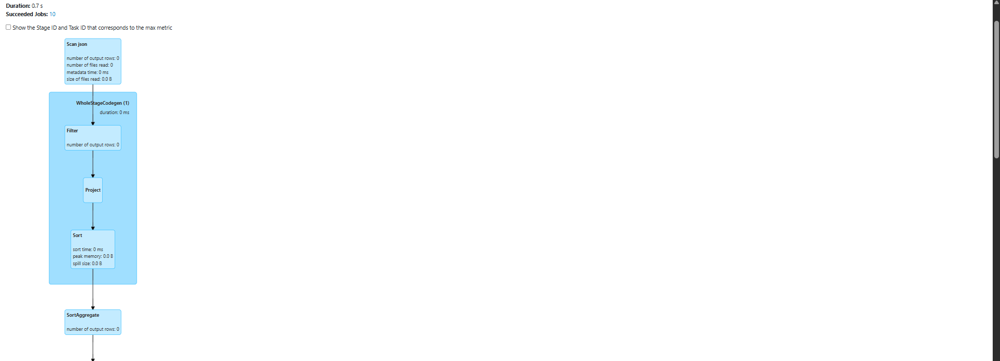 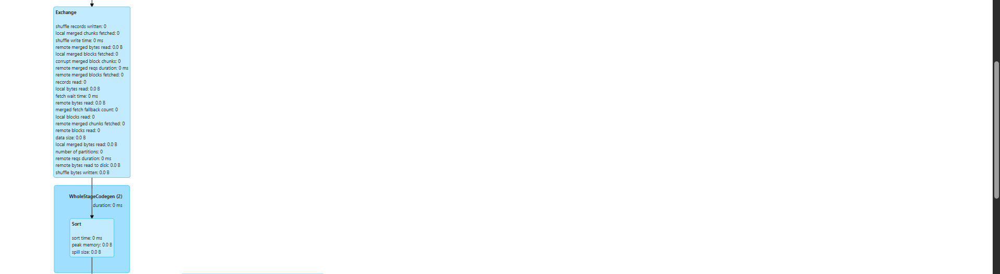 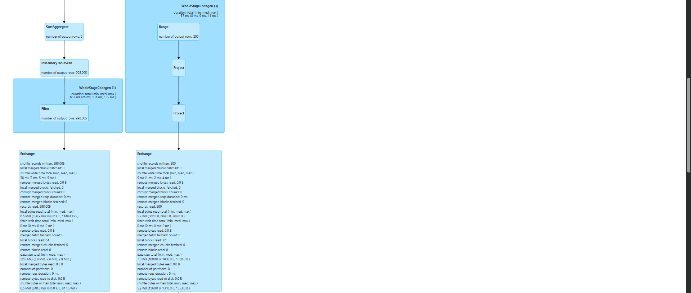 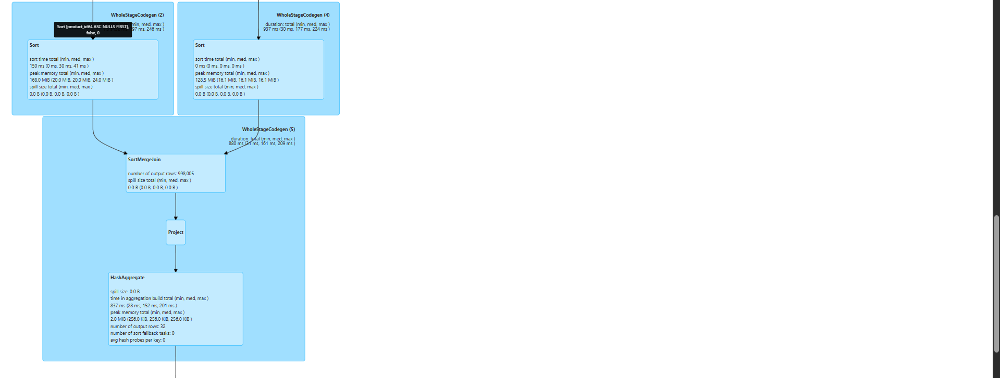 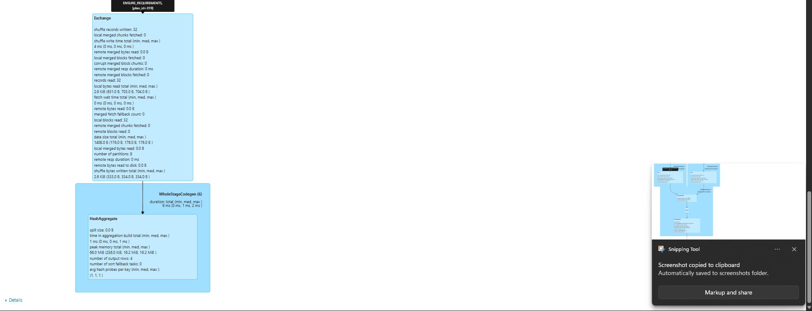

```text
Plan E 
== Physical Plan ==
* HashAggregate (20)
+- Exchange (19)
   +- * HashAggregate (18)
      +- * Project (17)
         +- * BroadcastHashJoin Inner BuildRight (16)
            :- * Filter (11)
            :  +- InMemoryTableScan (1)
            :        +- InMemoryRelation (2)
            :              +- SortAggregate (10)
            :                 +- * Sort (9)
            :                    +- Exchange (8)
            :                       +- SortAggregate (7)
            :                          +- * Sort (6)
            :                             +- * Project (5)
            :                                +- * Filter (4)
            :                                   +- Scan json  (3)
            +- BroadcastExchange (15)
               +- * Project (14)
                  +- * Project (13)
                     +- * Range (12)


(1) InMemoryTableScan
Output [2]: [product_id#4, amount#6L]
Arguments: [product_id#4, amount#6L], [isnotnull(product_id#4)]

(2) InMemoryRelation
Arguments: [run_id#0, order_id#1L, sale_date#35, city#26, product_id#4, quantity#5, amount#6L], CachedRDDBuilder(org.apache.spark.sql.execution.columnar.DefaultCachedBatchSerializer@7cb96362,StorageLevel(disk, memory, 1 replicas),SortAggregate(key=[run_id#0, order_id#1L], functions=[first(sale_date#35, false), first(city#26, false), first(product_id#4, false), first(quantity#5, false), first(amount#6L, false)], output=[run_id#0, order_id#1L, sale_date#62, city#54, product_id#56, quantity#58, amount#60L])
+- *(2) Sort [run_id#0 ASC NULLS FIRST, order_id#1L ASC NULLS FIRST], false, 0
   +- Exchange hashpartitioning(run_id#0, order_id#1L, 8), ENSURE_REQUIREMENTS, [plan_id=50]
      +- SortAggregate(key=[run_id#0, order_id#1L], functions=[partial_first(sale_date#35, false), partial_first(city#26, false), partial_first(product_id#4, false), partial_first(quantity#5, false), partial_first(amount#6L, false)], output=[run_id#0, order_id#1L, first#73, valueSet#74, first#75, valueSet#76, first#77, valueSet#78, first#79, valueSet#80, first#81L, valueSet#82])
         +- *(1) Sort [run_id#0 ASC NULLS FIRST, order_id#1L ASC NULLS FIRST], false, 0
            +- *(1) Project [run_id#0, order_id#1L, initcap(trim(city#3, None)) AS city#26, product_id#4, quantity#5, amount#6L, cast(gettimestamp(event_time#2, yyyy-MM-dd'T'HH:mm:ss, TimestampType, Some(Etc/UTC), false) as date) AS sale_date#35]
               +- *(1) Filter (((((((((isnotnull(quantity#5) AND isnotnull(product_id#4)) AND isnotnull(order_id#1L)) AND NOT (initcap(trim(city#3, None)) = )) AND isnotnull(cast(gettimestamp(event_time#2, yyyy-MM-dd'T'HH:mm:ss, TimestampType, Some(Etc/UTC), false) as date))) AND isnotnull(amount#6L)) AND (amount#6L >= 0)) AND (quantity#5 > 0)) AND (product_id#4 >= 1)) AND (product_id#4 <= 200))
                  +- FileScan json [run_id#0,order_id#1L,event_time#2,city#3,product_id#4,quantity#5,amount#6L] Batched: false, DataFilters: [isnotnull(quantity#5), isnotnull(product_id#4), isnotnull(order_id#1L), NOT (initcap(trim(city#3..., Format: JSON, Location: InMemoryFileIndex(484 paths)[s3a://raw/events/run_id=kelas-1m/partition=0/offset-000000008100-000..., PartitionFilters: [], PushedFilters: [IsNotNull(quantity), IsNotNull(product_id), IsNotNull(order_id), IsNotNull(amount), GreaterThanO..., ReadSchema: struct<run_id:string,order_id:bigint,event_time:string,city:string,product_id:int,quantity:int,am...
,None)

(3) Scan json 
Output [7]: [run_id#0, order_id#1L, event_time#2, city#3, product_id#4, quantity#5, amount#6L]
Batched: false
Location: InMemoryFileIndex [s3a://raw/events/run_id=kelas-1m/partition=0/offset-000000008100-000000009289.jsonl, ... 483 entries]
PushedFilters: [IsNotNull(quantity), IsNotNull(product_id), IsNotNull(order_id), IsNotNull(amount), GreaterThanOrEqual(amount,0), GreaterThan(quantity,0), GreaterThanOrEqual(product_id,1), LessThanOrEqual(product_id,200)]
ReadSchema: struct<run_id:string,order_id:bigint,event_time:string,city:string,product_id:int,quantity:int,amount:bigint>

(4) Filter [codegen id : 1]
Input [7]: [run_id#0, order_id#1L, event_time#2, city#3, product_id#4, quantity#5, amount#6L]
Condition : (((((((((isnotnull(quantity#5) AND isnotnull(product_id#4)) AND isnotnull(order_id#1L)) AND NOT (initcap(trim(city#3, None)) = )) AND isnotnull(cast(gettimestamp(event_time#2, yyyy-MM-dd'T'HH:mm:ss, TimestampType, Some(Etc/UTC), false) as date))) AND isnotnull(amount#6L)) AND (amount#6L >= 0)) AND (quantity#5 > 0)) AND (product_id#4 >= 1)) AND (product_id#4 <= 200))

(5) Project [codegen id : 1]
Output [7]: [run_id#0, order_id#1L, initcap(trim(city#3, None)) AS city#26, product_id#4, quantity#5, amount#6L, cast(gettimestamp(event_time#2, yyyy-MM-dd'T'HH:mm:ss, TimestampType, Some(Etc/UTC), false) as date) AS sale_date#35]
Input [7]: [run_id#0, order_id#1L, event_time#2, city#3, product_id#4, quantity#5, amount#6L]

(6) Sort [codegen id : 1]
Input [7]: [run_id#0, order_id#1L, city#26, product_id#4, quantity#5, amount#6L, sale_date#35]
Arguments: [run_id#0 ASC NULLS FIRST, order_id#1L ASC NULLS FIRST], false, 0

(7) SortAggregate
Input [7]: [run_id#0, order_id#1L, city#26, product_id#4, quantity#5, amount#6L, sale_date#35]
Keys [2]: [run_id#0, order_id#1L]
Functions [5]: [partial_first(sale_date#35, false), partial_first(city#26, false), partial_first(product_id#4, false), partial_first(quantity#5, false), partial_first(amount#6L, false)]
Aggregate Attributes [10]: [first#63, valueSet#64, first#65, valueSet#66, first#67, valueSet#68, first#69, valueSet#70, first#71L, valueSet#72]
Results [12]: [run_id#0, order_id#1L, first#73, valueSet#74, first#75, valueSet#76, first#77, valueSet#78, first#79, valueSet#80, first#81L, valueSet#82]

(8) Exchange
Input [12]: [run_id#0, order_id#1L, first#73, valueSet#74, first#75, valueSet#76, first#77, valueSet#78, first#79, valueSet#80, first#81L, valueSet#82]
Arguments: hashpartitioning(run_id#0, order_id#1L, 8), ENSURE_REQUIREMENTS, [plan_id=50]

(9) Sort [codegen id : 2]
Input [12]: [run_id#0, order_id#1L, first#73, valueSet#74, first#75, valueSet#76, first#77, valueSet#78, first#79, valueSet#80, first#81L, valueSet#82]
Arguments: [run_id#0 ASC NULLS FIRST, order_id#1L ASC NULLS FIRST], false, 0

(10) SortAggregate
Input [12]: [run_id#0, order_id#1L, first#73, valueSet#74, first#75, valueSet#76, first#77, valueSet#78, first#79, valueSet#80, first#81L, valueSet#82]
Keys [2]: [run_id#0, order_id#1L]
Functions [5]: [first(sale_date#35, false), first(city#26, false), first(product_id#4, false), first(quantity#5, false), first(amount#6L, false)]
Aggregate Attributes [5]: [first(sale_date#35)()#61, first(city#26)()#53, first(product_id#4)()#55, first(quantity#5)()#57, first(amount#6L)()#59L]
Results [7]: [run_id#0, order_id#1L, first(sale_date#35)()#61 AS sale_date#62, first(city#26)()#53 AS city#54, first(product_id#4)()#55 AS product_id#56, first(quantity#5)()#57 AS quantity#58, first(amount#6L)()#59L AS amount#60L]

(11) Filter [codegen id : 2]
Input [2]: [product_id#4, amount#6L]
Condition : isnotnull(product_id#4)

(12) Range [codegen id : 1]
Output [1]: [id#322L]
Arguments: Range (1, 201, step=1, splits=Some(4))

(13) Project [codegen id : 1]
Output [1]: [cast(id#322L as int) AS product_id#324]
Input [1]: [id#322L]

(14) Project [codegen id : 1]
Output [2]: [product_id#324, CASE WHEN ((product_id#324 % 4) = 0) THEN Elektronik WHEN ((product_id#324 % 4) = 1) THEN Fashion WHEN ((product_id#324 % 4) = 2) THEN Rumah Tangga ELSE Olahraga END AS category#326]
Input [1]: [product_id#324]

(15) BroadcastExchange
Input [2]: [product_id#324, category#326]
Arguments: HashedRelationBroadcastMode(List(cast(input[0, int, false] as bigint)),false), [plan_id=399]

(16) BroadcastHashJoin [codegen id : 2]
Left keys [1]: [product_id#4]
Right keys [1]: [product_id#324]
Join type: Inner
Join condition: None

(17) Project [codegen id : 2]
Output [2]: [amount#6L, category#326]
Input [4]: [product_id#4, amount#6L, product_id#324, category#326]

(18) HashAggregate [codegen id : 2]
Input [2]: [amount#6L, category#326]
Keys [1]: [category#326]
Functions [2]: [partial_count(1), partial_sum(amount#6L)]
Aggregate Attributes [2]: [count#2386L, sum#2387L]
Results [3]: [category#326, count#2388L, sum#2389L]

(19) Exchange
Input [3]: [category#326, count#2388L, sum#2389L]
Arguments: hashpartitioning(category#326, 8), ENSURE_REQUIREMENTS, [plan_id=405]

(20) HashAggregate [codegen id : 3]
Input [3]: [category#326, count#2388L, sum#2389L]
Keys [1]: [category#326]
Functions [2]: [count(1), sum(amount#6L)]
Aggregate Attributes [2]: [count(1)#2274L, sum(amount#6L)#2276L]
Results [3]: [category#326, count(1)#2274L AS orders#2275L, sum(amount#6L)#2276L AS gross_sales#2277L]

```

## 7. Partition pruning dan Iceberg
### A. Penyimpanan Tabel Curated & File di Bucket `warehouse`
Hasil pembersihan data dan agregasi bisnis disimpan sebagai tabel Apache Iceberg melalui Iceberg REST Catalog (`http://rest:8181`) ke bucket `warehouse` MinIO (`s3://warehouse/`):
* **`lake.curated.orders_clean`:** Menyimpan `998.005` baris transaksi bersih yang dipartisi berdasarkan kolom `sale_date` (`partitionedBy("sale_date")`).
* **`lake.curated.sales_summary`:** Menyimpan tabel agregasi ringkasan penjualan (`sale_date` × `city` × `category`) yang juga dipartisi berdasarkan `sale_date`.
* **File Curated & Metadata:** Di dalam bucket `warehouse` MinIO, Iceberg menyimpan file data (*data files*) terpisah menurut partisi `sale_date` beserta folder `metadata/` yang mencatat skema, partisi, dan *manifest* tabel.
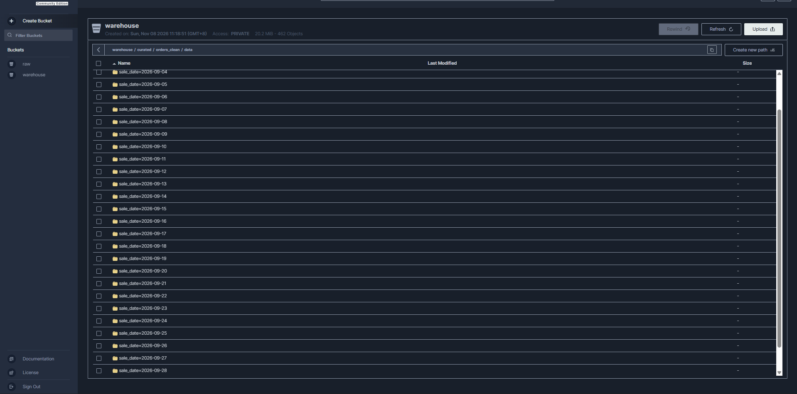 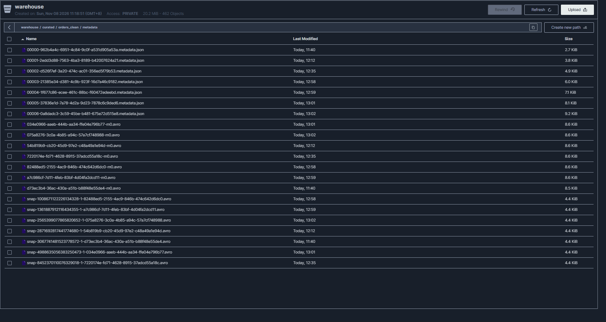

### B. Pengujian Partition Pruning (`sale_date = 2026-09-05`)
Untuk menguji apakah pemangkasan partisi bekerja, dijalankan kueri filter pada satu tanggal spesifik:
```python
spark.table("lake.curated.orders_clean").filter(
    F.col("sale_date") == F.lit("2026-09-05").cast("date")
)
```

## 8. Benchmark komparatif
Pengukuran dilakukan sebanyak tiga kali pengulangan pada dataset `kelas-1m` (`998.005` baris bersih yang di-*cache* pada `MEMORY_AND_DISK`), `8` *shuffle partitions*, `16` *salt buckets*, `AQE = false`, dan `autoBroadcastJoinThreshold = -1`.

| Eksperimen | Waktu percobaan 1 (s) | Percobaan 2 (s) | Percobaan 3 (s) | Median (s) | Temuan |
|---|---:|---:|---:|---:|---|
| GroupBy baseline | 0,623 | 0,606 | 0,597 | 0,606 | Baseline agregasi `groupBy("city")` memicu 1 tahap `Exchange` dan `HashAggregate` |
| Skew sebelum salting | 0,210 | 0,158 | 0,176 | 0,176 | Eksekusi lokal cepat, tetapi partisi sangat timpang (5 partisi kosong, `max=798.404`, `skew_index=6,40`) |
| Skew setelah salting | 0,394 | 0,257 | 0,333 | 0,333 | Partisi merata (`0` kosong, `max=281.164`, `skew_index=2,25`), namun lebih lambat (`Speedup 0,53x`) karena *overhead* hash + agregasi 2 tahap |
| SortMergeJoin | 0,672 | 0,822 | 0,793 | 0,793 | Lebih lambat karena memicu `Exchange` dan `Sort` pada kedua sisi tabel sebelum *join* |
| BroadcastHashJoin | 0,272 | 0,310 | 0,307 | 0,307 | Lebih cepat (`Speedup 2,58x`) karena tabel dimensi `dim` (200 baris) di-*broadcast* tanpa me-*shuffle* tabel fakta |

**Perhitungan Komparasi Berdasarkan Nilai Median:**
* **Rumus Modul:** $\text{Perubahan waktu (\%)} = \frac{\text{waktu\_baseline} - \text{waktu\_optimasi}}{\text{waktu\_baseline}} \times 100\%$ dan $\text{Speedup} = \frac{\text{waktu\_baseline}}{\text{waktu\_optimasi}}$.
* **Salting vs Skew Baseline:**
  * $\text{Perubahan waktu} = \frac{0,176 - 0,333}{0,176} \times 100\% = -89,20\%$ (terjadi perlambatan).
  * $\text{Speedup} = \frac{0,176}{0,333} = 0,53\text{x}$ ($< 1$, *overhead* pembagian *sub-key* dan *shuffle* dua tahap lebih besar daripada penghematan waktu *skew* pada mode lokal).
* **BroadcastHashJoin vs SortMergeJoin:**
  * $\text{Perubahan waktu} = \frac{0,793 - 0,307}{0,793} \times 100\% = +61,29\%$ (lebih cepat).
  * $\text{Speedup} = \frac{0,793}{0,307} = 2,58\text{x}$ (terbukti mempercepat eksekusi *join*).

## 9. Kesimpulan dan catatan keamanan
### A. Keberhasilan Optimasi dan Analisis Sebab-Akibat
1. **Broadcast Join (Berhasil Mempercepat Eksekusi):** Strategi `BroadcastHashJoin` terbukti efektif mempercepat proses *join* antara tabel fakta `cleaned` (`998.005` baris) dan tabel dimensi `dim` (`200` baris) dengan waktu median **0,307 detik** dibandingkan `SortMergeJoin` sebesar **0,793 detik** (*speedup* **2,58x** atau **+61,29%** lebih cepat). Hal ini terjadi karena `BroadcastExchange` mengirimkan salinan tabel dimensi kecil langsung ke *executor* sehingga menghilangkan fase *Exchange* (shuffle) dan *Sort* pada tabel fakta yang besar.
2. **Key Salting (Berhasil Meratakan Partisi, Belum Mempercepat Wall Time):** Penambahan kolom `salt` (`16` bucket) berhasil memperbaiki keseimbangan partisi secara drastis—partisi kosong berkurang dari `5` menjadi `0`, beban partisi maksimum turun dari `798.404` menjadi `281.164` baris, dan *skew index* membaik dari `6,40` ke `2,25` dengan hasil agregasi kota tetap identik. Namun, waktu eksekusi median justru melambat dari **0,176 detik** menjadi **0,333 detik** (*speedup* **0,53x** / **-89,20%**). Perlambatan ini disebabkan oleh *overhead* tambahan untuk komputasi hash `xxhash64`, *repartition* ekstra, dan agregasi dua tahap yang lebih berat daripada penghematan waktu *skew* pada dataset yang sudah ter-*cache* di memori lokal.
3. **Apache Iceberg & Partition Pruning (Berhasil):** Penyimpanan tabel `lake.curated.orders_clean` yang dipartisi berdasarkan `sale_date` berhasil memangkas pembacaan data saat kueri disaring pada satu tanggal spesifik (`2026-09-05` menghasilkan `33.268` baris).

### B. Perbedaan `local[4]` Mode dan Distributed Cluster
* **Spark `local[4]`:** Menjalankan 4 *thread* komputasi pada satu mesin dan satu JVM/kontainer yang sama. Driver dan eksekutor berbagi ruang memori serta disk lokal yang sama, sehingga perpindahan data (*shuffle*) tidak melewati jaringan fisik antarmesin dan batas *bottleneck* tidak sepenuhnya mencerminkan klaster besar.
* **Distributed Cluster (Multi-Worker):** Terdiri dari banyak *node* fisik/virtual terpisah yang terhubung melalui jaringan. Pada lingkungan terdistribusi, *shuffle* antar-*node* menimbulkan latensi I/O jaringan yang jauh lebih mahal, dan *data skew* yang menumpuk di satu *worker* berpotensi memicu *straggler task* maupun kegagalan *OutOfMemoryError*. Oleh karena itu, teknik *key salting* dan *broadcast join* akan memberikan dampak performa yang jauh lebih besar di klaster terdistribusi nyata dibandingkan mode lokal.

### C. Catatan Keamanan dan Keterbatasan Lingkungan Praktikum
* **Kredensial Dummy Lokal:** Username dan password MinIO/S3 (`labadmin` / `labpassword123`) pada `docker-compose.yml` hanya digunakan untuk simulasi laboratorium lokal dan **tidak boleh** dipakai pada server publik atau sistem produksi. Untuk produksi, wajib menggunakan manajemen rahasia (*secrets manager*), rotasi kunci akses, serta enkripsi TLS/HTTPS.
* **Konfigurasi Produksi:** Lingkungan praktikum ini memakai 1 broker Redpanda (*replication factor* 1) yang belum menguji skenario *failover* multi-broker, mematikan AQE (`spark.sql.adaptive.enabled = false`) serta *auto-broadcast* (`-1`) untuk kepentingan pengujian manual, dan memakai `.createOrReplace()` pada penulisan Iceberg. Untuk penerapan produksi, AQE sebaiknya diaktifkan serta diperlukan mekanisme *upsert/merge* dan kontrol idempotensi yang lebih kuat.

## Lampiran
Link repo Git; output quality.json; screenshot Spark UI dengan job ID; screenshot MinIO dan Iceberg.
